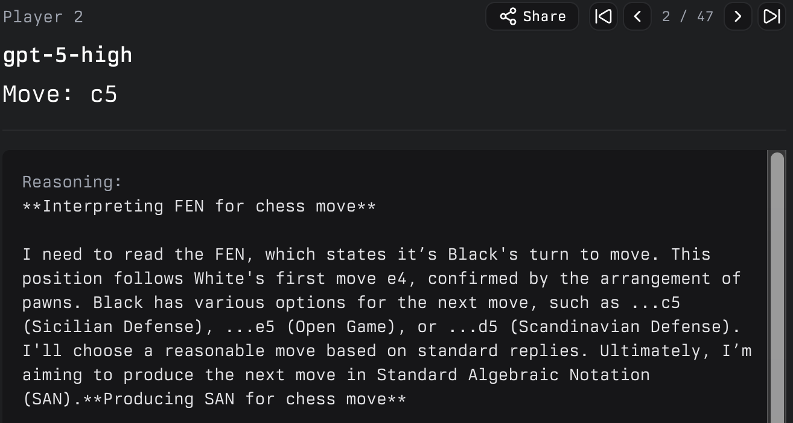

# llm-game-arena

[Google Game Arena](https://github.com/google-deepmind/game_arena?tab=readme-ov-file)

[OpenSpiel](https://openspiel.readthedocs.io/en/latest/games.html) (Google used this as well), but I want to use it for evals and automation at first, and then can move up to building more complex games

[Other LM Arena](https://github.com/lmarena/arena-hard-auto/tree/main), where it introduces [interesting research paper](https://arxiv.org/pdf/2406.11939)

### Critical:
- Create pipeline to do simple evals for OpenSpiel games
    - Route it to utils, show graphs, update benchmarks accordingly
    - Scale information and send it to Postgres DB
- Capture reasoning like from [Game-Arena](https://game-arena.ai/game/chess-standard):

    - Capture and detail other relevant data and quantitative measures

### Future:
- Create simple envs for complex games
    - Wavelength style games; Codenames, Hues and Cues, etc.
    - Explorative vs exploitative games
    - Adversarial and collaborative
- Batch process evals with AI-AI arena and human-AI style
    - Make generalizations and causal inference
- Allow open source modeling and fine-tuning at will (would be hard to batch process though)
- Make frontpage UI using [v0](https://v0.app/chat)

### Far future:
- Monetization?