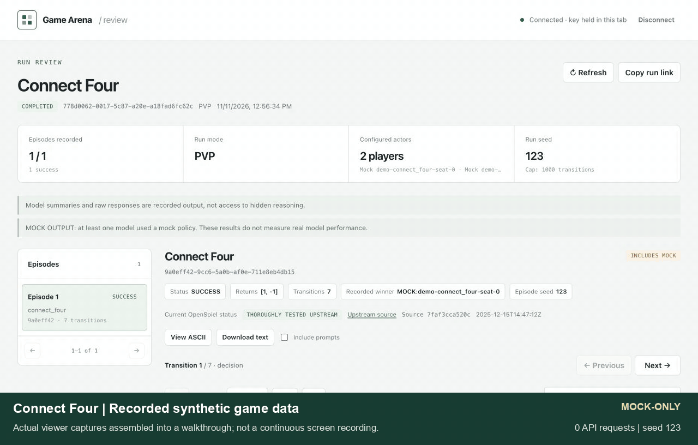
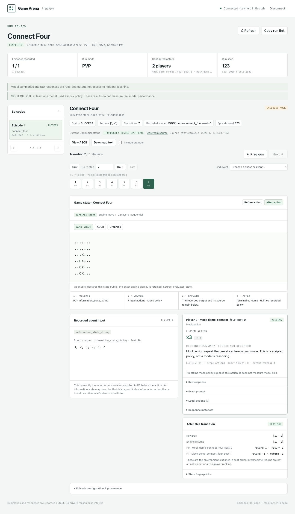
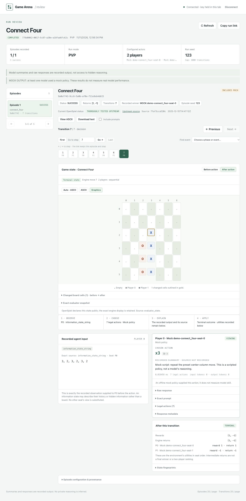
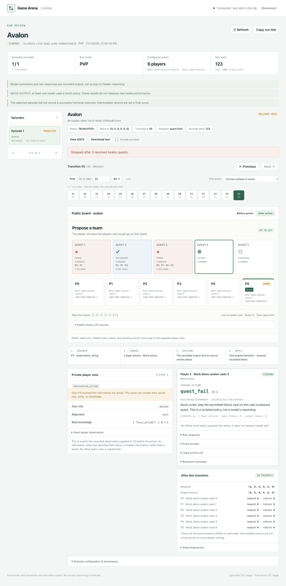
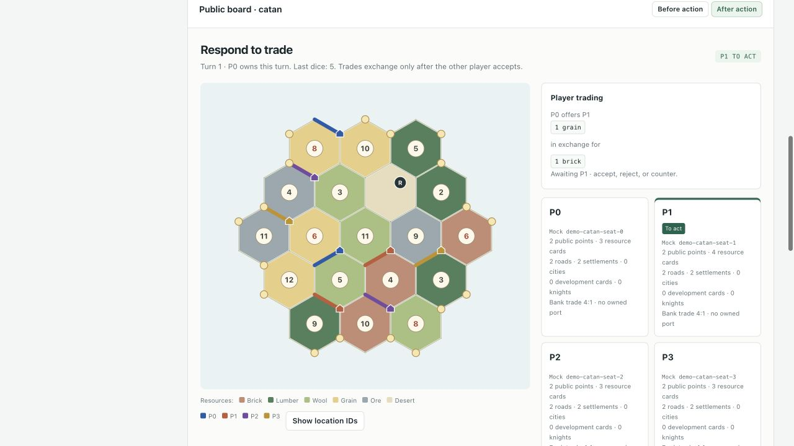
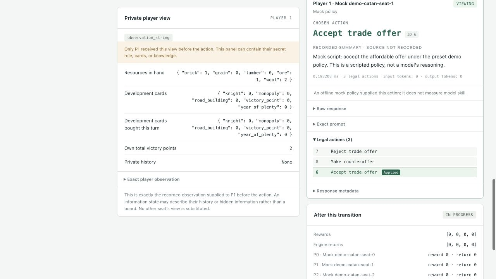

# LLM Game Arena

Generate understandable, reproducible synthetic experience for reinforcement
learning agents. This project runs game environments with mock policies,
seeded baselines, or model-backed agents and records what each agent observed,
which legal action it chose, and what happened next. The goal is to make synthetic
data easy to generate, inspect, replay, and feed into an RL agent's training or
evaluation pipeline. LLM arena competitions are one source of these trajectories.

The harness combines a local experiment planner, queued workers, the installed
OpenSpiel registry, and standalone Python game environments. It follows each
state's node kind, supports arbitrary player counts, and records replayable
transition data. It does not require paid model access to generate datasets.

**No model API permissions are needed for the offline workflow.** Planning is the
default. Local execution requires `--execute-mock` and constructs only mock models.
No provider SDK client is created by that path.

## See it working

The test walkthrough below uses **scripted mock agents and real game rules**.
It steps through Connect Four, three Avalon quest outcomes, and a Catan resource
trade. The video is assembled from actual viewer captures; no model APIs were
called, and its policy descriptions are not real model reasoning.

https://github.com/user-attachments/assets/48294f07-6a01-4b99-9d2d-6fae286fb398

<details>
<summary>Animated preview</summary>

[](docs/media/arena-demo.mp4)

</details>

[Watch or download the H.264 demo video](docs/media/arena-demo.mp4).

<details>
<summary>Working viewer screenshots</summary>

**Connect Four:** ASCII is the default. Steps preserve exact engine boards,
legal actions, supplied observations, and the recorded policy output.



**Optional graphics:** switch presentation without changing the recorded game.



**Avalon:** the mission track, public votes, and phase index make the three
resolved quests easy to follow. This demo deliberately stops after quest three.



**Catan:** the board and pending trade show who offers what and which player
must accept, reject, or counter. Resources exchange only after acceptance.



**Decision evidence:** inspect the acting player's recorded view beside the
chosen action, scripted description, and legal alternatives.



</details>

To recreate the demo with no provider credentials, seed a new local directory:

```bash
uv run python scripts/seed_demo.py --output analytics/viewer-demo

# Read-only viewing uses the existing API with a disposable local Redis service.
docker run --detach --rm --name arena-viewer-demo-redis --publish 127.0.0.1:56387:6379 redis:7-alpine
export PYTHON_DOTENV_DISABLED=1 MODEL_API_MOCK_MODE=true WORKER_TRIGGER_MODE=none
export DATABASE_TARGET=temporary_local REDIS_HOST=127.0.0.1 REDIS_PORT=56387
export DATABASE_URL="$(uv run python -c 'import json; print(json.load(open("analytics/viewer-demo/manifest.json"))["database_url"])')"
export ARENA_API_KEYS=readme-demo-key # pragma: allowlist secret -- disposable local demo key only
export API_HOST=127.0.0.1 API_PORT=8010
uv run python -m orchestrator.api_gateway
```

Open `http://127.0.0.1:8010/reports`, use the local demo key above, and choose a run
ID from `analytics/viewer-demo/manifest.json`. Its highlight indices are
zero-based; the website's **Go to step** input is one-based. Use a new output
directory for another build: the seeder refuses to overwrite existing data.
Stop the API with Ctrl-C and remove its disposable service with
`docker stop arena-viewer-demo-redis` when finished.

## Synthetic data for RL agents

Use mock policies to exercise an environment and produce reproducible synthetic
trajectories before connecting a funded model or a learned policy. Every episode
keeps its game parameters, seed, agent identity, legal action choices, rewards,
terminal status, and transition evidence. Recorded observations are scoped to the
acting player; evaluator traces may include several players' private information.

To feed exported data into your RL environment or offline training pipeline:

1. Generate a seeded mock dataset with `plan --execute-mock` below.
2. Replay it to verify the environment transitions and checksums.
3. Export JSONL records and join them by episode, transition, and player. Construct
   the observation/action/reward/next-observation records your learner expects;
   simultaneous and chance transitions need their own handling.
4. Keep the legal action mask, acting player's information boundary, and the
   distinction between `COMPLETED`, `TRUNCATED`, `STOPPED`, and `FAILED` episodes.

Mock behavior is labeled synthetic test behavior, not expert play. An agent's
recorded explanation is its supplied output, not a verified account of its
internal reasoning. This repository supplies environments and auditable data;
the consuming RL training loop and its dataset transformation remain your choice.

## Start without credentials or services

Use Python 3.12+ and the checked-in dependency lock:

```bash
uv sync --frozen

# List games compiled/registered in this installation.
uv run python -m game_arena.openspiel catalog

# Inspect an exact configuration before scheduling it.
uv run python -m game_arena.openspiel catalog --inspect 'kuhn_poker(players=3)'

# Dry-run: inspect capabilities, calculate episode count, preview stable jobs.
uv run python -m game_arena.openspiel plan \
  --games tic_tac_toe kuhn_poker matrix_rps matching_pennies_3p catch \
  --episodes 4 --seed 123 --output analytics/offline-demo

# Explicit mock-only build test. Redis, Postgres, and API keys are unnecessary.
uv run python -m game_arena.openspiel plan \
  --games tic_tac_toe kuhn_poker matrix_rps matching_pennies_3p catch \
  --episodes 4 --seed 123 --output analytics/offline-demo --execute-mock
```

A single model label (the default `mock`) enables selfplay for any player count.
For a tournament, provide distinct labels with `--models alpha beta gamma`; the
planner generates combinations of the game’s player count. Episode count is per
matchup. Seat assignments rotate across episodes; use a multiple of the player
count for equal seat exposure. `--no-seat-rotation` preserves fixed assignments.
Offline labels always refer to local mock models, including labels such as GPT.

`--max-steps` caps state transitions, including chance and mean field transitions;
its default is 1000. An episode that reaches the cap is `TRUNCATED` and does not
contribute a fabricated win. Terminal return vectors are the primary outcome for
solo, multiplayer, cooperative, and general-sum games.

## Game support and capability boundaries

The catalog reports the registry’s player bounds, observation APIs, dynamics,
chance mode, parameter requirements, and reproducibility requirements. A registry
entry is a declaration, not proof that every parameterization works. Exact
configuration inspection runs in a subprocess because invalid native game
constructors can abort a process. Python games are registered when their optional
upstream dependencies are available; missing dependencies are reported.

The generic execution path handles:

- Sequential decisions, including games where the same player acts repeatedly.
- Simultaneous decisions collected before applying a joint action.
- Explicit chance outcomes sampled from a separate, seeded RNG stream.
- Any supported player count, including one-player games.
- Imperfect information through player-scoped information/observation APIs.
- Sampled stochastic games with a reproducibly seeded underlying environment.
- Mean field updates when an explicit population distribution is provided.

Games requiring a wrapped `game=...`, a file, or other required parameters must be
specified with those parameters. External environments that cannot be initialized
or reproduced locally are rejected with a reason. Adding a game to OpenSpiel does
not require adding a notation dictionary entry to this repository.

For a mean field experiment, explicitly select a distribution:

```bash
uv run python -m game_arena.openspiel plan \
  --games mfg_crowd_modelling --mean-field-distribution uniform \
  --episodes 2 --seed 123 --output analytics/mean-field-demo --execute-mock
```

The uniform distribution is an exogenous experimental assumption, **not a solved
mean field equilibrium**. The chosen distribution and population are recorded.
Programmatic configuration also accepts a support-state-to-probability mapping.

Player prompts contain only that player’s scoped view and legal action IDs. The
full evaluator trace can include private observations for several players and
should be treated as evaluation data. Generic text/tensor views provide legal
play; game-specific strategy explanations and image observations are not supplied
automatically.

## Reproduction and replay

Each plan records the exact configuration, inspected game metadata, Python and
OpenSpiel versions, prompt/parser schema versions, source revision, and a hash of
the working source. A different build or configuration needs a new output
directory. Actual episodes also record their effective OpenSpiel specification,
seed, assigned agents, raw model output, selected legal actions, fallbacks,
chance events, reward/return vectors, and state hashes.

A seed controls the harness’s chance, random opponent, and fallback streams. Real
remote model responses may vary even when a provider accepts a seed. Exact
trajectory replay uses recorded actions and never calls a provider.

```bash
# Use an episode_id from the plan preview or an episode summary file.
uv run python -m game_arena.openspiel replay \
  --dataset analytics/offline-demo --episode <EPISODE_ID>
```

Replay checks legal transitions, recorded state hashes, and resulting utilities.
A mismatch identifies incompatible game behavior or modified evidence. Preserving
the dependency lock, source build, and any external files referenced by a game
specification at their recorded absolute paths is necessary for long-term
reproduction. File-backed definitions record SHA-256 hashes and byte sizes;
their contents are not embedded. Replay requires the retained files and checks
their hashes before loading the game. The source hash covers repository Python
code; it does not archive external game assets.

## Standalone game environments

Jev can act as a typed legal-action policy through `JEV:jev-1.14.0`. It records
classifier probabilities and confidence instead of generated explanations.
The [Jev client setup](CLIENT_GUIDE.md#jev-typed-decision-agents) includes the
funded-key requirement, mock mode, and a shared $0.10 capped Avalon trial.

One Night Werewolf, original Avalon, base Coup, and base Catan have model-independent
Python rules engines. Validate and replay them without AI or OpenSpiel before
using the existing runner, reports, or dataset pipeline. See the
[environment guide](game_arena/environments/README.md) for exact supported rules,
player counts, parameter validation, and commands.

```bash
uv run python -m game_arena environments simulate --game 'avalon(players=5)' --seed 123 --output analytics/avalon-baseline.json
uv run python -m game_arena environments replay analytics/avalon-baseline.json
```

Database collections can be exported with `python -m game_arena export-db`, or
downloaded per run from authenticated `GET /v1/runs/{run_id}/export`. See the
[client guide](CLIENT_GUIDE.md#export-a-collection).

## Large experiments and datasets

Plans generate jobs lazily. Mock execution uses at most `2 * workers` pending jobs
by default and a process pool for `--workers > 1`; each worker holds at most one
episode trace in memory. Increase `--max-pending` only when needed. Memory does not
grow with the total number of episodes, while episode size still depends on its
step cap and observation/action-space size.

```bash
uv run python -m game_arena.openspiel plan \
  --games tic_tac_toe kuhn_poker matrix_rps --episodes 10000 --seed 123 \
  --output analytics/batch --execute-mock --workers 4
```

Independent machines can share a dataset directory through disjoint shards:

```bash
# Run indexes 0, 1, 2, and 3 independently with the same plan/build.
uv run python -m game_arena.openspiel plan \
  --games tic_tac_toe kuhn_poker matrix_rps --episodes 10000 --seed 123 \
  --output analytics/sharded --execute-mock --workers 2 \
  --shard-index 0 --shard-count 4
```

Sharding and worker count do not change episode IDs, seeds, or seat assignments.
Run each shard once at a time. Reissuing the same command resumes committed
episodes after checking their job identity and checksums; corrupt records are
reported rather than silently skipped. An interrupted episode can be rerun.
Execution exceptions are recorded as `FAILED` evidence with no invented return
vector and are retried on resume. The CLI exits with a nonzero status when any
episode fails.

Dataset layout:

```text
manifest.json
 episodes/<bucket>/<episode-id>.json
 episodes/<bucket>/<episode-id>.steps.jsonl
```

Transition streams are flushed and atomically replaced before the corresponding
summary is committed. Temporary/orphan transition files are not completion
markers. One episode is the persistence/retry unit.

Export normalized, streamed JSONL files for downstream analysis or ingestion:

```bash
uv run python -m game_arena.openspiel export \
  --dataset analytics/offline-demo --output analytics/offline-export
```

The exporter verifies the source and writes `episodes.jsonl.gz`,
`steps.jsonl.gz`, and `decisions.jsonl.gz`, plus an export manifest. Use
`--uncompressed` for plain JSONL. Join decisions to steps with `episode_id` and
`step_index`; `decision_index` distinguishes simultaneous players. Row order is
not a semantic identifier. Export and resume verification stream files rather
than accumulating the run in memory.

## API, queue, and runner

The service path remains `FastAPI → Redis/RQ → orchestrator.runner → Postgres`.
The runner creates runtime workers listening for independent episode jobs.
Per-episode seeds remove the need to chain episodes for deterministic randomness.
Queued submission validates game capabilities and player counts before creating
run records, batches queue writes, and uses stable job/episode identities for
retries. Persistence retains actual player IDs instead of inferring players by
turn parity. Versioned run configuration, episode summary, and transition tables
are added alongside the existing tables; existing rows remain readable.

A durable dispatch marker preserves partially submitted runs through Redis
outages. The runner retries pending dispatches at startup and every 60 seconds
with the same job IDs. A submission `503` includes the run ID and polling URL;
status responses report dispatch completion separately from episode completion.
Queued runs pin their source, dependency, and OpenSpiel versions. A worker with a
different build records a clear failure before creating a model client. Queue
delivery is at least once; stable episode IDs deduplicate persisted results.

```bash
docker compose up --build
```

The compose stack explicitly supplies a development gateway key. Outside that
stack, set `ARENA_API_KEYS` yourself: missing or empty configuration authorizes
no requests. The standalone API binds to `127.0.0.1` by default; set `API_HOST`
explicitly for a container or private network listener. Provider credentials
belong on workers and are separate from gateway keys. Unexpected backend errors
return a request ID and safe diagnostics rather than raw connection credentials.

The compose configuration defaults to mock behavior. For explicit mock jobs, use
`MOCK` in API `model_names`; this is independent of provider credentials:

```bash
curl -X POST http://localhost:8000/v1/runs \
  -H 'Authorization: Bearer local-dev-key' \
  -H 'Content-Type: application/json' \
  -d '{"run_type":"PVP","env":"kuhn_poker(players=3)","num_episodes":3,"num_steps":100,"model_names":["MOCK","MOCK","MOCK"],"seed":123,"rotate_seats":true}'
```

`env` accepts native OpenSpiel specifications. `connect_four_v1` and `chess_v1`
remain compatibility aliases. `PVP` needs one model per seat, `PVP_RR` generates
n-player combinations, `RAND` places one model against random policies in other
seats, and `INPUT` supplies a fixed opponent action sequence for one episode.
Server-local filename/path parameters, including nested game specifications, are
disabled for API and queue submissions. Use the trusted offline CLI for file-backed
definitions; their recorded hashes are checked against the plan before execution.

Read [CLIENT_GUIDE.md](CLIENT_GUIDE.md) for endpoint details. Generic metrics expose
clean terminal returns per player/agent, with fallback-assisted returns reported
separately. Fallback-assisted episodes are excluded from Elo. Existing Connect Four
plots and two-player Elo are specialized views; they do not rank cooperative or
multiplayer games with an arbitrary winner rule.

Database and deployment configuration remains in
[infra/gcp/README.md](infra/gcp/README.md). `DATABASE_URL` overrides the configured
target; `DATABASE_TARGET=raspberry_pi` or `gcp` selects the corresponding URL. The
Pi target can be reached at `100.116.74.50` over the configured Tailscale network.
Local offline planning, execution, export, and replay never connect to that DB.

## Read a run report

The API serves a browser report at `http://localhost:8000/runs/RUN_ID`, or open
`http://localhost:8000/reports` and enter a run ID. Enter the API key in the page's
key field. The browser keeps it in page memory; it is not saved in the URL or
browser storage. Run creation and status responses provide `report_url`,
`text_report_url`, and `report_data_url` links.

The report shows episode outcomes, recorded moves, player observations, model
summaries, and raw responses. Jump directly to a numbered step, choose a phase
from the index, or use the previous/next and first/last controls. Step links
retain the episode and step in the URL so a position can be revisited.
New native traces include public boards before and after every transition.
Avalon shows quest results, the proposed team, leader, and resolved approval
votes; pending ballots and hidden roles stay out of the public board. The
recorded actor's private view remains a separate panel. Older traces can show
public facts extracted from their saved observations, labelled as such; an
unrecorded after-state is not invented.
OpenSpiel games share a review panel with the node type, active seats, engine
move number, and public display. Connect Four and other clear ASCII boards use
their original engine text by default; switch to **Graphics** for an available
grid view. Chess, Go, Hex, and 2048 default to graphics. **ASCII** always retains
the exact engine display, including annotations outside a parsed board. Public
games without a dedicated grid use lossless text; hidden-information games show
an explicit public-board limitation alongside each acting player's exact view.

Each decision identifies how its action was selected: model response, offline
mock, classifier, forced action, random baseline, input script, or fallback.
Simultaneous choices stay separate by seat. The selected legal action is marked,
and failed responses remain available when a fallback supplied the applied move.
Grid changes compare recorded before/after cells; they do not infer a strategy.
The catalog and viewer also retain OpenSpiel's official maturity distinction:
🟢 thoroughly tested and 🔶 implemented but lightly tested. Games marked ❌ with
known upstream issues are excluded from new runs, including through nested game
transformations. Historical traces remain readable and replayable. Utility and
test registrations not individually rated in the upstream table are labelled
unrated; a successful local check does not promote their upstream status. These
viewer changes leave the installed game implementations and rules unchanged.
Summaries contain text supplied by the model and do not expose hidden reasoning.
Mock models supply placeholder explanations. Evaluator data can contain private
observations from several players. Failed or older episodes show available
evidence and notices when traces are missing.

For an ASCII report in the terminal, replace `RUN_ID` in this single-line command:

```bash
curl -sS 'http://localhost:8000/v1/runs/RUN_ID/report?format=text&step_limit=20' -H 'Authorization: Bearer local-dev-key'
```

The same authenticated endpoint returns JSON by default. Episodes and transitions
are paginated; select an `episode_id` and use `step_offset` to continue through
its moves. See [CLIENT_GUIDE.md](CLIENT_GUIDE.md#inspect-a-run-in-the-browser-or-terminal)
for all report parameters. Viewing reports reads persisted results and does not
call a model provider. The existing API serves the website; no additional hosting
service or paid deployment is needed.

## Validation

```bash
uv sync --frozen --no-install-project --group ci
uv run ruff check --fix
uv run ruff format
uv run pyright
uv run --group ci python scripts/test_suites.py --suite all --report analytics/ci-tests/all.json

# Run the same independent suites as GitHub Actions.
uv run --group ci python scripts/test_suites.py --suite unit
uv run --group ci python scripts/test_suites.py --suite integration
uv run --group ci python scripts/test_suites.py --suite regression
uv run --group ci python scripts/test_suites.py --suite security

# Offline source scans; medium/high Bandit findings fail CI.
uv run --group ci bandit -r game_arena orchestrator data utils config scripts --severity-level medium
uv run --group ci python scripts/scan_secrets.py --report analytics/ci-security/secrets.json

# Dependency advisories need network access, but never model API credentials.
uv export --frozen --group ci --no-emit-project --no-hashes --format requirements-txt --output-file analytics/ci-security/requirements.txt
uv run --group ci pip-audit --requirement analytics/ci-security/requirements.txt --no-deps --disable-pip

# Model-free viewer coverage, including parameterized game fixtures.
uv run python scripts/viewer_conformance.py --seed 123 --max-steps 96 --output analytics/viewer-coverage.json --jsonl-output analytics/viewer-coverage.jsonl

# Bounded, isolated checks for all default-loadable installed games.
uv run python -m game_arena.openspiel.conformance --max-steps 96 --timeout 20

# With disposable PostgreSQL and Redis explicitly configured:
uv run python scripts/generic_e2e_ci.py
```

Use the mock-only command above as the feature build test. The queued integration
smoke additionally needs Redis/Postgres and is exercised by the GitHub workflow.
Before pushing, run the repository workflows through `act` with Docker as required
by the project instructions. No live provider benchmark is required for a build
test.

Pushes to `main` and pull requests run separate lint/type, unit, integration,
regression, security, offline environment, and queued Postgres/Redis checks.
The suite registry rejects unclassified or duplicate test modules, including the
retained legacy tests. The runner overrides ambient provider keys, database
configuration, and model mode before importing tests, so ordinary test execution
cannot accidentally target the Pi or a funded provider. External-service tests
use the workflow's disposable Postgres and Redis containers.

Unit/integration/regression jobs publish JSON results and coverage XML. The
security job tests auth, privacy, error handling, and provider transport; scans
source for medium/high severity defects; scans the current tracked/nonignored
source snapshot for credentials without online key verification; and audits
locked dependencies against live advisories. It runs weekly as well as on code
changes. Reviewed non-secret fixtures are narrowly annotated rather than
excluding all tests or disabling entropy detection. This snapshot scan is not a
historical Git secret audit. No scanner proves the absence of vulnerabilities.
Actions are pinned to immutable revisions, use read-only repository permissions,
and receive no live provider secrets. Dependabot checks action updates weekly.

## Hosting and storage planning

The intended small deployment is an always-on API, Redis queue, and PostgreSQL
server, with `orchestrator.runner` workers on that machine or a separate Mac.
Start with modest concurrency; 10,000 queued episodes do not require 10,000
simultaneous workers. Use private networking such as the existing Tailscale link
to the Pi, durable SSD storage, service restart policies, and tested off-host
backups. A Pi 4 can be a reasonable coordinator; its actual throughput and ARM
dependency installation still need verification on your hardware.

A local measurement on November 11, 2026 generated three complete mock Catan
games with the default four players, 500-turn cap and 200 actions/turn cap. All
reached terminal draws at the turn cap; no model APIs were called. The mean was
2,172 transitions and 1,609 agent decisions per game. Extrapolating the observed
sample to **10,000 games**, retaining all turns, gives approximately:

- **1.09 TB** canonical uncompressed JSON files.
- **128 GB** gzip archives at compression level 6.
- **265 GB** actual PostgreSQL 17 table, TOAST, and index storage, excluding WAL,
  backups, maintenance headroom, and future growth.
- **1.19 TB** SQLite storage, which does not provide PostgreSQL's row compression.

These are alternatives, not sizes to add unless retaining multiple copies.
The sample's mock responses average about 60 bytes. Longer real responses and
different policies increase storage; every extra 1 KiB per decision contributes
about 16.5 GB before duplication/compression across this batch. Full prompts,
private observations, before/after boards, and cumulative action histories are
retained. History can make long-game storage grow quadratically. These numbers
are a measured planning sample, not a worst-case bound or a Pi performance test.

A 512 GB SSD could hold the sample-scaled PostgreSQL database with backups stored
elsewhere; **1 TB is safer**. A microSD card is a poor target for sustained large
database writes. [Ubuntu's Pi guidance](https://ubuntu.com/tutorials/how-to-install-ubuntu-desktop-on-raspberry-pi-4)
describes the performance benefit of USB 3 SSD storage. Keeping completed
compressed trajectories in object storage and only searchable metadata in
PostgreSQL is a useful next architecture step, but automatic archival/hydration
is not implemented by this change.

For an AWS price comparison, a public-IPv4 Lightsail instance with 2 vCPUs, 4 GB
RAM and 80 GB disk is **$24/month ($288/year)**. Adding 512 GB of Lightsail block
storage at $0.10/GB-month brings compute plus provisioned disk to **$902.40/year**,
before backups, tax, excess transfer, or model inference. See the current
[instance bundles](https://docs.aws.amazon.com/lightsail/latest/userguide/amazon-lightsail-bundles.html)
and [storage pricing](https://aws.amazon.com/lightsail/pricing/). Existing Pi disk
has no cloud rental fee; power, replacement hardware, and off-site backups still
have a cost. API inference is separate from these storage/hosting estimates.

In US East (N. Virginia), S3 Standard's first-tier rate is $0.023 per billable
GB-month. AWS uses binary GB for S3 billing: the measured 128.4 decimal GB gzip
copy is about 119.6 billable GB, or **$33/year for one retained archive copy**.
Requests, downloads beyond free allowances, and extra retained backup versions
cost more. Object storage is an archive, not a substitute for a running database.
Rates were checked against AWS's public price list on November 11, 2026; see
[S3 pricing](https://aws.amazon.com/s3/pricing/).

Reproduce the mock measurement's data generation with:

```bash
uv run python -m game_arena plan --games catan --episodes 3 --max-steps 100037 --seed 123 --output analytics/storage-sample --execute-mock --workers 1
```

For a fresh disposable PostgreSQL database, compare the sum of
`pg_total_relation_size` for all public application tables before and after
persisting the sample with the normal worker path. That includes indexes and
TOAST; filesystem size additionally includes WAL and database system files.

The old `game_arena/openspiel/prompts.py` template and `data/collect.py` placeholder
are cleanup candidates. The generic engine uses `views.py`; notation helpers
remain for compatibility with existing board-game responses.

## Upstream contracts

The engine follows [OpenSpiel’s state API](https://openspiel.readthedocs.io/en/stable/api_reference.html)
and [upstream implementation](https://github.com/google-deepmind/open_spiel).
[Google DeepMind Game Arena](https://github.com/google-deepmind/game_arena) is a
reference for model competition and recording decisions. This repository provides
its own orchestration, reproduction, and dataset layer rather than copying a
fixed set of Game Arena game adapters.
